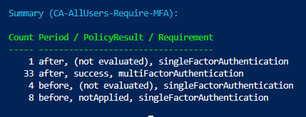
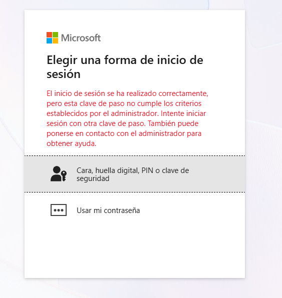
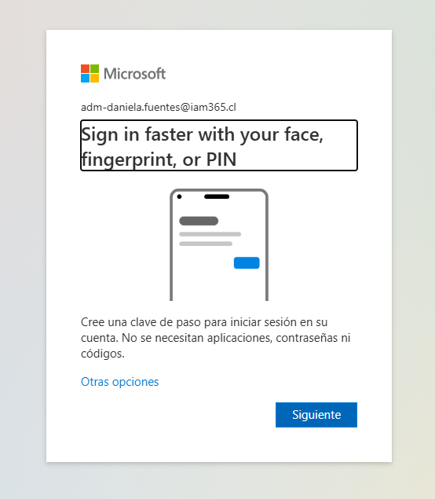
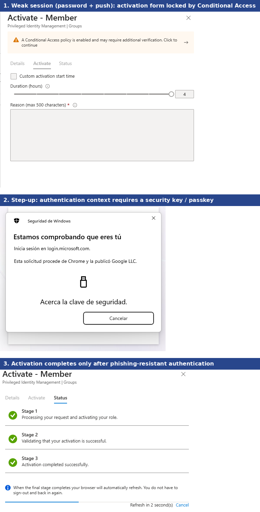
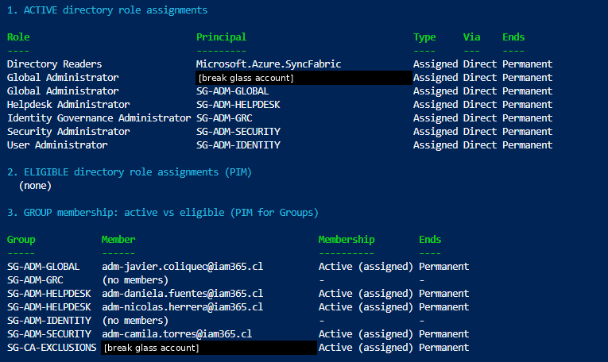
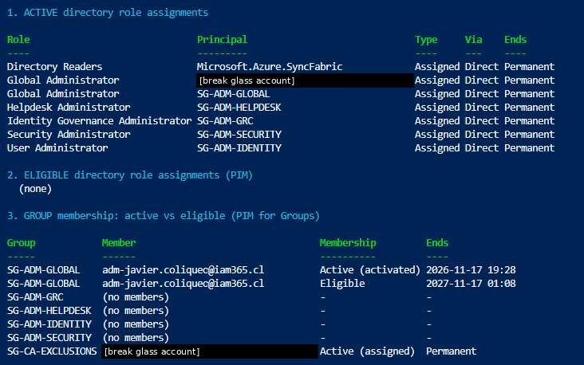

# Case 01 — Privileged Access Hardening in Microsoft Entra ID

> **Environment:** IAM365 lab tenant (Microsoft Entra ID P2), built for SC-300 preparation
>
> **My role:** sole administrator and auditor of the tenant
>
> **Tools:** Entra admin center, Conditional Access, Authentication methods, Privileged Identity Management (PIM), Access Reviews, What If, sign-in logs, Microsoft Graph PowerShell

---

## Summary

I built this Entra ID tenant in mid-2026 as a hands-on lab while preparing for, and passing, the **SC-300 (Microsoft Identity and Access Administrator)** exam. When I came back to it months later to build this portfolio, I treated it as an **inherited environment**: before adding anything new, I audited how it protected its most powerful accounts.

The audit showed that **shortcuts taken while studying had outlived their purpose**. An MFA exclusion I had added so a misconfigured policy couldn't lock me out was never removed. Test admin accounts were still enabled with only a password. Every admin role was assigned permanently. And while admins were required to use MFA, nothing required it to be phishing-resistant.

I logged **13 findings**, 6 of them high severity. **9 are remediated or contained** with before/after evidence, **2 are formally risk-accepted** with compensating controls, and **2 remain open** with a recommendation. The remediation moved every admin to **just-in-time access through PIM**, where getting a role always requires a passkey. It also put the Conditional Access exclusion group under time-bound, alerted and monthly-reviewed control. Every change was tested before and after.

| Outcome | Before | After |
|---|---|---|
| MFA enforced on the primary Global Admin | ❌ Excluded (single-factor sign-ins in logs) | ✅ Enforced (multi-factor in every sign-in) |
| Phishing-resistant MFA required for admin roles | ❌ Any MFA accepted (push / OTP) | ✅ Passkeys only (FIDO2 / device-bound) |
| Standing admin access | ❌ Permanent membership in every admin group | ✅ None: eligible only, activated for max 4 h with a passkey and a justification |
| Exceptions to Conditional Access | ❌ Permanent until someone remembers | ✅ Max 15 days, justified, email alert, monthly access review |
| Break glass outside every Conditional Access policy | ❌ Included in 1 policy | ✅ 0 policies apply (What If) |
| Stale and password-only admin accounts | ❌ 6 enabled | ✅ Disabled, removed from every admin group |
| Strong authentication methods on the primary admin | 1 security key | 2 device-bound passkeys + recovery path |

---

## 1. Risk

Privileged accounts are the shortest path to full tenant compromise. If an attacker controls a Global Administrator, they control every identity, application and policy in the tenant.

The controls that matter most are:

- **Strong authentication on every admin account, with no exceptions.** Push notifications and one-time codes can be phished; passkeys (FIDO2) cannot.
- **No standing privilege.** An admin role that is always on is always available to whoever steals the account.
- **An emergency-access account that still works when everything else fails,** and that no policy change can lock out.
- **No standing access that nobody uses.** Stale admin accounts are an attack surface with no business value.

The question for this case was the one you should ask of any environment you inherit: *do these controls actually do what everyone thinks they do?*

---

## 2. Environment

| Component | Configuration |
|---|---|
| Licensing | Entra ID P2 |
| Admin model | Role-assignable groups (RBAC), one group per role, managed with **PIM for Groups** |
| Emergency access | 1 cloud-only break glass account (BG01), permanent Global Admin, FIDO2 security key, outside PIM |
| Exclusion group | `SG-CA-EXCLUSIONS`: BG01 as the only permanent member |
| Admin accounts | 1 primary admin (eligible via PIM); 5 test admin accounts disabled |

**Role matrix (verified with Graph):**

| Group | Entra role |
|---|---|
| SG-ADM-GLOBAL | Global Administrator |
| SG-ADM-IDENTITY | User Administrator |
| SG-ADM-HELPDESK | Helpdesk Administrator |
| SG-ADM-SECURITY | Security Administrator |
| SG-ADM-GRC | Identity Governance Administrator |

---

## 3. What I built

### Conditional Access (final state)

| Policy | Target | Control | State |
|---|---|---|---|
| CA-Block-Legacy-Authentication | All users (excl. SG-CA-EXCLUSIONS) | Block legacy protocols | On |
| CA-AllUsers-Require-MFA | All users (excl. SG-CA-EXCLUSIONS) | Require MFA | On |
| CA-Admin-Session-12h | Admin directory roles (excl. SG-CA-EXCLUSIONS) | Sign-in frequency 12 h | On |
| **CA-Admins-Require-PhishingResistantMFA** | All admin directory roles (excl. SG-CA-EXCLUSIONS) | **Authentication strength: Phishing-resistant MFA** | **On** |
| **CA-PIM-Activation-Require-PhishingResistantMFA** | All users (excl. SG-CA-EXCLUSIONS), **authentication context "PIM activation"** | **Authentication strength: Phishing-resistant MFA** | **On** |

### Just-in-time admin access (PIM for Groups)

Each admin group keeps its Entra role **permanently**. What became just-in-time is **membership** of the group: admins are *eligible* members and activate their membership, and therefore the role, only when they need it.

| Setting (all 5 SG-ADM-* groups) | Value |
|---|---|
| Activation maximum duration | 4 hours |
| On activation, require | Conditional Access **authentication context** → phishing-resistant MFA |
| Justification on activation | Required |
| Eligible assignments | Expire after 1 year (no permanent eligibility) |
| Active assignments (made by an admin) | Expire after 15 days (no permanent active membership), MFA + justification |
| Notifications | Email alert on every activation and every new assignment |

The settings were configured and tested on SG-ADM-GLOBAL, then **copied to the other four groups with a Graph script** ([`Copy-PimGroupSettings.ps1`](../../scripts/Copy-PimGroupSettings.ps1)) so all admin groups follow identical rules.

### Governance of the exclusion group (`SG-CA-EXCLUSIONS`)

| Control | Configuration |
|---|---|
| PIM for Groups | No permanent assignments: new exclusions last **max 15 days**, with MFA and justification. Self-activation, if ever made eligible: max 1 h with MFA. |
| Alerting | Email on every new exclusion (eligible or active) and on every activation |
| Access Review | **Monthly** review of all members (active and eligible); results auto-applied; justification required |
| Break glass | The only permanent member, a documented exception |

### Passkey (FIDO2) profile

- Device-bound passkeys only (synced passkeys rejected)
- Attestation enforced
- AAGUID allow-list: YubiKey 5 Series NFC and Microsoft Authenticator (iOS)

📎 **Evidence:** [`passkey-profile.png`](evidence/passkey-profile.png)

### Validation tooling

What If simulations, sign-in log analysis (portal JSON export and Graph `beta/auditLogs/signIns`), and seven Graph PowerShell scripts. See [Scripts](#10-scripts).

---

## 4. What I found

I logged 13 findings, ordered by severity. Select a number to jump to its detail, or to the recommendation that closed it:

| # | Finding | Severity | Status |
|---|---|---|---|
| [1](#f1) | Build-phase MFA exclusion for the primary Global Admin never removed | **High** | ✅ Remediated, and recurrence prevented |
| [2](#f2) | No phishing-resistant MFA requirement for admin roles | **High** | ✅ Remediated |
| [3](#f3) | 5 admin-named accounts with password only and no MFA registered (3 with delegated roles, 2 with no role and no sign-in since creation) | **High** | ✅ Contained: accounts disabled and removed from admin groups until onboarding with a Temporary Access Pass |
| [4](#f4) | Registering a new credential is protected only by standard MFA, or by nothing at all on a password-only account | **High** | ⬜ Open |
| [5](#f5) | Break glass and primary admin depended on the same single FIDO2 key | **High** | ⚪ Risk accepted, with compensating controls |
| [6](#f6) | Privileged roles held permanently (no just-in-time access) | **High** | ✅ Remediated (PIM) |
| [7](#f7) | Previous admin account still enabled and licensed after 135 days without use | Medium | ✅ Remediated |
| [8](#f8) | Break glass included in a Conditional Access policy | Medium | ✅ Remediated |
| [9](#f9) | Primary admin had no password-recovery path (SSPR) | Medium | ✅ Remediated |
| [10](#f10) | A "privileged" dynamic group driven by job title rather than actual roles; attribute-based groups include admin accounts | Medium | ⬜ Open |
| [11](#f11) | Primary admin held Global Admin plus a redundant User Admin role | Low | ✅ Remediated |
| [12](#f12) | Two legacy CA policies: one redundant and misnamed (targeted an Audit group), one test policy | Low | ✅ Retired |
| [13](#f13) | Guest account with no current business purpose and no MFA registered in the tenant | Low | ⚪ Risk accepted (billing dependency) |

**Controls verified (no finding):**
- The role-assignable admin groups and the exclusion group have **no owners**. Group owners can add members, so an owner would be a way into an admin role that bypasses PIM.
- The break glass account signs in and holds Global Admin. I tested this before every change that could affect it.

**Selected findings in detail.** The rest are summarized in the table and in [Recommendations](#6-recommendations).

### Finding 1: A temporary exception that became permanent

While building the Conditional Access baseline during my SC-300 preparation, I deliberately added the primary admin account to `SG-CA-EXCLUSIONS`. That way a misconfigured policy could not lock me out during testing. This is common practice during a rollout, **but the exception had no end date and no owner review, so it was never removed**.

When the baseline moved to **On (19 June 2026)**, the exclusion stayed in place. The account with the most privileges ended up as the only user, apart from the break glass, not covered by the Require-MFA policy. When I came back to the tenant, the audit caught it in November.

**Why it matters:** the same thing happens in real environments when a project ends and nobody reviews the exceptions it left behind. "Temporary" exclusions are one of the most common ways Conditional Access gets silently weakened. The fix was trivial. The lesson is the process: every exception needs a reason, an owner and an expiry date.

The sign-in logs of 6 November show the before and after on the same day ([`Compare-SignInMfaRequirement.ps1`](../../scripts/Compare-SignInMfaRequirement.ps1)):

| Period (UTC) | Sign-ins | Require-MFA result | Authentication requirement |
|---|---|---|---|
| 14:16 – 19:20 (excluded) | 8 | `notApplied` | `singleFactorAuthentication` |
| 19:49 onwards (remediated) | 33 | `success` | `multiFactorAuthentication` |

   
  <em>Same day, same account: single-factor while excluded, multi-factor after the fix.</em>

> **Honest note:** during the exclusion window the account was in practice used with a passkey. The finding is that **the control was missing**, so a password alone would have been enough. It is not that weak authentication was observed.

**Preventing recurrence:** the exclusion group is now under PIM, so the next "temporary" exclusion **cannot be permanent**. It lasts at most 15 days, requires a justification and sends an email alert. I tested this by excluding a disabled test account: the request was capped at 15 days and the alert arrived. A **monthly Access Review** of the group catches anything added outside PIM. Two settings were adapted for the break glass:
- **"If reviewers don't respond" is set to *No change*.** A missed review must never remove the break glass from the exclusion group.
- **The "no sign-in in 30 days" decision helper is off.** An emergency account is *supposed* to be unused, so the helper would recommend removing it every month.

📎 **Evidence:** [`signins-before-after.csv`](evidence/signins-before-after.csv) · [`exclusion-group-pim-test.png`](evidence/exclusion-group-pim-test.png) · [`access-review-exclusions.png`](evidence/access-review-exclusions.png)

### Finding 2: "Require MFA" was not enough for admins

"Require multifactor authentication" is satisfied by any MFA method, including push notifications, which can be relayed or approved through fatigue attacks. I created `CA-Admins-Require-PhishingResistantMFA` from Microsoft's template. While validating it I found that the template:

- **excluded the current user (me) by default**, which would have recreated Finding 1, and
- **did not include Identity Governance Administrator**, the role of one of my admin groups.

I corrected both and verified with a Graph script ([`Test-AdminPolicyCoverage.ps1`](../../scripts/Test-AdminPolicyCoverage.ps1)) that every role assigned through `SG-ADM-*` is in the policy scope.

   
  <em>The passkey profile at work: a synced passkey (iCloud Keychain) is rejected; only device-bound passkeys are accepted.</em>

📎 **Evidence:** [`ca-policy-phishing-resistant.png`](evidence/ca-policy-phishing-resistant.png) · [`policy-coverage.png`](evidence/policy-coverage.png) · [`passkey-profile.png`](evidence/passkey-profile.png) · [`report-only-results.png`](evidence/report-only-results.png)

### Finding 3: Admins with password only

Three delegated admin accounts (Helpdesk, Security) had only a password and no MFA registered, even though a Require-MFA policy was On. **Whoever knows the password can register their own MFA at the first sign-in.**

A wider sweep **by naming convention** ([`Find-AdminNamedAccounts.ps1`](../../scripts/Find-AdminNamedAccounts.ps1)), rather than by group membership, found **two more "ADM" accounts in the same state, but with no Entra role at all and no sign-in since they were created**. Because they hold no directory role, the admin-focused policies did not even apply to them. They were still members of operational groups and of a group named `DG-PRIVILEGED`.

My first assumption was that the new phishing-resistant policy would leave these accounts "blocked by design". **Testing showed that this was wrong.** The policy raises the bar to *use* the account, but not to *register* its first credentials. Someone with only the password can register Authenticator, then use that fresh MFA to create a passkey, and end up holding a phishing-resistant credential for an admin account (see Finding 4).

**Containment:** all five accounts are **disabled**, and their memberships in the admin groups were **removed through PIM** with a justification. A disabled account cannot sign in or register anything. If they are needed again, they will be re-enabled through a **Temporary Access Pass** issued by an administrator and given an *eligible* (not active) membership, so the password is never the entry point.

📎 **Evidence:** [`admin-named-accounts.png`](evidence/admin-named-accounts.png) · [`admin-accounts-disabled.png`](evidence/admin-accounts-disabled.png)

### Finding 4: Strong credentials can be bootstrapped from weak ones

While testing the block on a delegated admin, Entra asked for standard MFA (password + Authenticator push) and then **offered to create a passkey**. Anyone holding those weaker credentials could have registered a phishing-resistant credential for that admin. On a password-only account the chain is even shorter: password → register Authenticator → register a passkey. The registration attempt failed, and I confirmed with Graph that no passkey was created.

This is why the severity is High. **A strong authentication policy is only as strong as the process that issues the strong credentials.**

   
  <em>After a password + push sign-in, Entra offers to create a passkey for a delegated admin.</em>

**Recommendation:** a Conditional Access policy on the *Register security information* user action that requires a trusted location and/or a **Temporary Access Pass** issued by an administrator.

### Finding 5: One key for two critical accounts (risk accepted)

The break glass account and the primary admin were both protected by the same YubiKey. Losing that one key would have locked out **both** accounts at once.

**What changed:** the primary admin now also has an independent, device-bound passkey in Microsoft Authenticator. If the YubiKey is lost, the primary admin can still sign in, issue a **Temporary Access Pass** to the break glass account and register a new key for it. A lockout would now require two independent failures at the same time.

**Decision: risk accepted** instead of creating a second break glass account with a second security key.

| | |
|---|---|
| **Rationale** | Lab tenant with a single administrator; a second hardware key has a cost; the residual risk is low after the primary admin got an independent recovery path. Password-only emergency accounts are not an option, because Microsoft now enforces MFA on the Azure portal and the Entra admin center. |
| **Compensating controls** | YubiKey protected by a PIN and stored securely · periodic break glass sign-in test · alert on any break glass sign-in (see [Recommendations](#6-recommendations)) |
| **Review trigger** | Re-evaluate if the tenant moves to production use or gains more administrators. In production, the recommendation stands: **two break glass accounts with independent credentials**. |

### Finding 6: Standing privilege → just-in-time access

Before the change, every admin was a **permanent member** of a role-assignable group, so every admin role was always on. I moved all five admin groups to **PIM for Groups**:

1. **Inventory first.** A Graph script ([`Get-PrivilegedAccessInventory.ps1`](../../scripts/Get-PrivilegedAccessInventory.ps1)) recorded who held which role, how (direct or through a group) and until when. Everything was *Assigned / Permanent*.
2. **Safety net.** I tested the break glass sign-in before touching anything. It holds Global Admin directly, outside PIM.
3. **Configure, then switch.** I configured the PIM rules on SG-ADM-GLOBAL while still a permanent member, made myself *eligible*, and only then removed my permanent membership. After that, my account showed **"No roles assigned"** until I activated.
4. **Standardize.** A script ([`Copy-PimGroupSettings.ps1`](../../scripts/Copy-PimGroupSettings.ps1)) copied the 19 PIM rules of SG-ADM-GLOBAL to the other four groups. Its *WhatIf* run showed the gap it closed: those groups would have allowed **8-hour activations with no passkey**.
5. **Remove the remaining standing access.** The permanent memberships of the disabled test admins were removed through PIM.

**A gap I found along the way:** `CA-Admins-Require-PhishingResistantMFA` targets *directory roles*. With just-in-time access, an admin **holds no role between activations**, so that policy no longer applies to the sign-in used to *request* a role. A session opened with a password and a push notification would have been enough to activate Global Admin.

**Fix:** a Conditional Access **authentication context** ("PIM activation") required by PIM on every activation, and a policy that maps it to **phishing-resistant MFA**. I tested it both ways:
- **From a passkey session**, activation went through.
- **From a password + push session**, the activation form was locked with *"A Conditional Access policy is enabled and may require additional verification"* until I used the security key.

   
  <em>Activation requested from a password + push session: locked by Conditional Access until the security key is used.</em>

Day-to-day work needs standard MFA. **Getting an admin role always needs a passkey.**

**Reading the inventory correctly:** after PIM, the role assignments of the groups still show as *permanent*. That is by design, because the group holds the role. What changed is **who is inside the group and for how long**. The before/after evidence for this finding is the group membership section of the inventory, not the role section.

   
  <em>Before: every admin membership permanent.</em>

   
  <em>After: one eligible membership; no standing access.</em>

📎 **Evidence:** [`pim-settings-standardized.png`](evidence/pim-settings-standardized.png)

### Finding 7: Disabled ≠ no access

The previous admin account was disabled, its sessions revoked and its P2 license removed. After disabling it, the account **remained a member of an attribute-based dynamic group** (`usageLocation = CL`). Disabling an account does not remove its group memberships. That matters for any access granted through those groups. (Related to Finding 10.)

📎 **Evidence:** [`stale-admin-offboarding.png`](evidence/stale-admin-offboarding.png)

### Finding 10: A "privileged" group that doesn't track privilege

`DG-PRIVILEGED` is a dynamic group with the rule `user.jobTitle -contains "Privileged"`. That has two consequences:

- **Membership ≠ privilege.** The group contained accounts with no admin role at all, and nothing guarantees that it includes everyone who actually holds one. Any control or report scoped to this group would target the wrong population.
- **Membership is controlled by an editable text field.** Anyone who can change a user's job title, whether a User Administrator or an HR sync, decides who is "privileged".

**Recommendation:** scope privileged controls by **directory roles** or by **role-assignable groups**, as the phishing-resistant policy does. Microsoft does not allow role-assignable groups to use dynamic membership, precisely so that an attribute change can never grant a privileged role. Keep `DG-*` groups for non-privileged purposes and exclude admin accounts from attribute-based rules.

📎 **Evidence:** [`dg-privileged-rule.png`](evidence/dg-privileged-rule.png)

> **About Finding 13:** the naming-convention sweep also returned the guest account used for billing, because its personal email address happens to start with "adm.". It holds no role, but it has no MFA registered in the tenant, so at its next sign-in the Require-MFA policy would let it register its own MFA: the same self-registration pattern as Finding 3, with low impact. A naming match is not proof of privilege, so the sweep script ([`Find-AdminNamedAccounts.ps1`](../../scripts/Find-AdminNamedAccounts.ps1)) now shows the account type (member or guest).
>
> 📎 **Evidence:** [`admin-named-accounts.png`](evidence/admin-named-accounts.png)

---

## 5. Testing

### 5.1 Phishing-resistant MFA for admins

The policy was deployed in **Report-only**, validated ([`Get-CAPolicyResults.ps1`](../../scripts/Get-CAPolicyResults.ps1) for the result of each sign-in, [`Check-AdminAuthMethods.ps1`](../../scripts/Check-AdminAuthMethods.ps1) for admins without a phishing-resistant method), and then switched to **On** with a second admin session open as a fallback.

| Test | Account | Method | Report-only result | Enforced (On) |
|---|---|---|---|---|
| Positive 1 | Primary admin | YubiKey (FIDO2) | `reportOnlySuccess` | ✅ Access granted |
| Positive 2 | Primary admin | Passkey in Microsoft Authenticator (device-bound) | `reportOnlySuccess` | ✅ Access granted |
| Negative | Delegated admin (Helpdesk) | Password + Authenticator push | `reportOnlyInterrupted` | Azure Portal: `failure` (blocked). ⚠️ But the security-info registration flow was still reachable and offered a passkey (Finding 4) → account disabled |
| Exclusion | Break glass (BG01) | FIDO2 | Not applied (What If: 0 policies) | ✅ Access granted |
| Passkey profile | Primary admin | Synced passkey (iCloud Keychain) | — | ⛔ Rejected: "passkey does not meet the criteria set by your administrator" |

📎 **Evidence:** [`report-only-results.png`](evidence/report-only-results.png) · [`synced-passkey-rejected.png`](evidence/synced-passkey-rejected.png) · [`whatif-breakglass-before-after.png`](evidence/whatif-breakglass-before-after.png)

### 5.2 Just-in-time access (PIM)

| Test | Expected | Result |
|---|---|---|
| Admin without an active role | No admin rights between activations | ✅ "No roles assigned" |
| Activation from a passkey session | Role granted for max 4 h with a justification | ✅ Global Admin active, with an end time |
| Activation from a password + push session | Step-up to phishing-resistant MFA before activation | ✅ Form locked by Conditional Access until the security key was used |
| New sign-in while the role is active | Admin policy applies as soon as the role is active | ✅ Passkey required at sign-in |
| Settings on all five admin groups | Identical rules | ✅ Script verification: 4 h / authentication context / justification / eligible 1 year / active 15 days |
| Standing memberships after the change | None | ✅ Inventory: only an *eligible* membership for the primary admin |

📎 **Evidence:** [`pim-activation-stepup.png`](evidence/pim-activation-stepup.png) · [`pim-settings-standardized.png`](evidence/pim-settings-standardized.png) · [`pim-inventory-after.png`](evidence/pim-inventory-after.png)

### 5.3 Exclusion group

| Test | Expected | Result |
|---|---|---|
| Exclude a (disabled) test account | No permanent exclusion possible | ✅ Capped at 15 days; justification required |
| Alert on a new exclusion | Email to the administrator | ✅ Received (who, whom, until when, why) |
| Monthly access review | Reviewer confirms each member with a justification | ✅ First review completed; break glass approved as a documented exception |

📎 **Evidence:** [`exclusion-group-pim-test.png`](evidence/exclusion-group-pim-test.png) · [`access-review-exclusions.png`](evidence/access-review-exclusions.png)

---

## 6. Recommendations

**Done:**
- Removed the primary admin from the exclusion group (F1)
- Put the exclusion group under PIM (max 15 days, justification, alerts) and a monthly Access Review, so a temporary exclusion can't become permanent again (F1)
- Enforced phishing-resistant MFA for every admin role (F2)
- Disabled the 5 password-only admin-named accounts and removed their admin-group memberships until TAP-based onboarding (F3)
- Added a second device-bound passkey for the primary admin, registered in Microsoft Authenticator, and formally accepted the residual single-key risk for the break glass (F5)
- Moved every admin to just-in-time access with PIM for Groups, with standardized settings, and required phishing-resistant MFA on every activation through an authentication context (F6)
- Disabled the stale admin account, revoked its sessions and removed its license (F7)
- Excluded the break glass from all CA policies (F8) · [`whatif-breakglass-before-after.png`](evidence/whatif-breakglass-before-after.png)
- Enabled a password-recovery path for the primary admin (F9)
- Removed the redundant User Admin role (F11)
- Retired two legacy CA policies (F12)

**Next:**
1. **Conditional Access on credential registration** with a Temporary Access Pass (F4)
2. **Alert on any break glass sign-in.** Being excluded from every CA policy only works if its use is monitored. This is also a compensating control for F5 (F5, F8)
3. **Redesign `DG-PRIVILEGED`**, or retire it, and exclude admin accounts from attribute-based dynamic groups (F10)
4. **Periodic break glass sign-in test**, documented (F5)

---

## 7. What I'd do differently

- **Give every exception an expiry date from day one.** The build-phase exclusion should have been time-boxed from the start. That is what the exclusion group now enforces: PIM for Groups caps every exclusion at 15 days with a justification and an alert, and a monthly Access Review checks the members. Without Entra ID P2, a scheduled Graph script that flags any member other than the break glass would be the minimum.
- **Remember that just-in-time access changes who Conditional Access applies to.** Policies that target directory roles stop applying to admins between activations. Protect the *activation* itself with an authentication context.
- **Always review exclusions after creating a policy from a template.** Microsoft's template excluded the creating admin by default. The sign-in logs show the new policy as `reportOnlyNotApplied` for my account until I fixed it.
- **Never let the break glass and a daily admin share a single authenticator.** Losing that one key would have locked out both accounts.
- **Test the assumption, not just the policy.** I expected the new policy to block the password-only admins, but the test showed they could still bootstrap a passkey. Enforcing strong authentication and controlling how strong credentials are issued are two separate controls.
- **Sweep by more than one attribute.** A check by group membership missed two admin accounts; a check by naming convention found them, plus a guest that was not an admin. Combine both, and look at the account type.
- **Plan for log latency.** Sign-in logs sometimes took much longer than expected to appear, and the Graph API timed out on filtered queries. Validate with *What If* before a change, confirm with the logs after, and send logs to Log Analytics or a SIEM for real-time troubleshooting and alerting.

---

## 8. Control mapping

Auditors and hiring managers often ask *"which control does this satisfy?"* This section translates the technical work into the language of audit and compliance, using three widely used references:

| Framework | What it is | Typically used by |
|---|---|---|
| **ITGC** (IT General Controls) | The baseline IT controls tested in financial-statement audits such as SOX: access to programs and data, change management and IT operations. A category of audit practice, not a single published standard. | Listed companies, financial and insurance sectors, external auditors |
| [**ISO/IEC 27001:2022**](https://www.iso.org/standard/27001) | International, certifiable standard for an information security management system (ISMS). Its Annex A lists 93 controls. | Organizations seeking certification worldwide |
| [**NIST SP 800-53 Rev. 5**](https://csrc.nist.gov/publications/detail/sp/800-53/rev-5/final) | Detailed catalogue of security and privacy controls, grouped in families, e.g. **AC** = Access Control, **IA** = Identification and Authentication, **AU** = Audit and Accountability | US government; widely used as a reference by private companies |

| Control area | ITGC | ISO/IEC 27001:2022 (Annex A) | NIST SP 800-53 Rev. 5 | Findings |
|---|---|---|---|---|
| Privileged access restricted, time-bound and reviewed | Logical access: privileged users | 8.2 Privileged access rights | AC-2, AC-6 | F1, F3, F6, F11 |
| Strong authentication for admins | Logical access: authentication | 8.5 Secure authentication | IA-2(1), IA-2(2) | F2, F5, F6 |
| Credential lifecycle (registration, recovery) | Logical access: password / credential management | 5.17 Authentication information | IA-5 | F4, F9 |
| Timely removal of unused access | Logical access: user termination | 5.18 Access rights | AC-2(3) | F3, F7 |
| Identity management and least privilege | Logical access: provisioning | 5.15 Access control, 5.16 Identity management | AC-2, AC-6(5) | F10, F11, F12, F13 |
| Periodic review of exceptions and access | Logical access: user access reviews | 5.18 Access rights | AC-2(j) | F1 |
| Logging and monitoring of privileged use | Monitoring of privileged activity | 8.15 Logging, 8.16 Monitoring activities | AU-6, AC-2(4) | F1, F6, F8 |

---

## 9. Evidence

Key screenshots are shown inline in [What I found](#4-what-i-found). Every artifact is listed here; select a name to open it.

| Artifact | Shows |
|---|---|
| [`evidence/signins-before-after.csv`](evidence/signins-before-after.csv) | Finding 1: every sign-in before and after removing the exclusion (sanitized) |
| [`evidence/signins-before-after-summary.png`](evidence/signins-before-after-summary.png) | Finding 1: summary of the same data, reproduced with a script |
| [`evidence/exclusion-group-pim-test.png`](evidence/exclusion-group-pim-test.png) | Finding 1: exclusion capped at 15 days, justification required, email alert |
| [`evidence/access-review-exclusions.png`](evidence/access-review-exclusions.png) | Finding 1: monthly access review of the exclusion group, first review completed |
| [`evidence/ca-policy-phishing-resistant.png`](evidence/ca-policy-phishing-resistant.png) | Finding 2: the admin policy enforced |
| [`evidence/policy-coverage.png`](evidence/policy-coverage.png) | Finding 2: every role assigned to an admin group is covered by the policy; only the exclusion group is excluded |
| [`evidence/report-only-results.png`](evidence/report-only-results.png) | Finding 2: positive and negative test results |
| [`evidence/passkey-profile.png`](evidence/passkey-profile.png) | Finding 2: device-bound, attestation and AAGUID allow-list |
| [`evidence/synced-passkey-rejected.png`](evidence/synced-passkey-rejected.png) | Finding 2: profile rejecting a synced passkey |
| [`evidence/admin-accounts-disabled.png`](evidence/admin-accounts-disabled.png) | Finding 3: the five password-only admin accounts disabled (Graph output) |
| [`evidence/admin-named-accounts.png`](evidence/admin-named-accounts.png) | Findings 3 and 13: sweep by naming convention, including account type |
| [`evidence/register-passkey-offer.png`](evidence/register-passkey-offer.png) | Finding 4: passkey registration offered after standard MFA |
| [`evidence/pim-inventory-before.png`](evidence/pim-inventory-before.png) | Finding 6: every admin membership permanent |
| [`evidence/pim-settings-standardized.png`](evidence/pim-settings-standardized.png) | Finding 6: identical PIM rules on all five admin groups |
| [`evidence/pim-activation-stepup.png`](evidence/pim-activation-stepup.png) | Finding 6: activation from a weak session locked until phishing-resistant MFA |
| [`evidence/pim-inventory-after.png`](evidence/pim-inventory-after.png) | Finding 6: only an eligible membership remains; no standing access |
| [`evidence/stale-admin-offboarding.png`](evidence/stale-admin-offboarding.png) | Finding 7: disabled, no roles, no licenses, but still 1 group membership |
| [`evidence/whatif-breakglass-before-after.png`](evidence/whatif-breakglass-before-after.png) | Finding 8: 1 policy → 0 policies |
| [`evidence/dg-privileged-rule.png`](evidence/dg-privileged-rule.png) | Finding 10: dynamic membership rule based on job title |

*Sanitization: usernames are not treated as secrets and remain visible. The break glass identity is redacted because it is excluded from Conditional Access. Tenant IDs, object IDs, the old `onmicrosoft` admin account and personal email addresses are also removed.*

---

## 10. Scripts

All scripts are in [`/scripts`](../../scripts), documented, and use Microsoft Graph PowerShell.

| Script | Purpose | Findings |
|---|---|---|
| [`Compare-SignInMfaRequirement.ps1`](../../scripts/Compare-SignInMfaRequirement.ps1) | Before/after of a CA MFA policy for one account, from Graph or a portal JSON export | F1 |
| [`Get-CAPolicyResults.ps1`](../../scripts/Get-CAPolicyResults.ps1) | Result of a CA policy (On or Report-only) per sign-in, with the method used | F2 |
| [`Test-AdminPolicyCoverage.ps1`](../../scripts/Test-AdminPolicyCoverage.ps1) | Role matrix, policy coverage of every admin role, and policy exclusions | F2 |
| [`Check-AdminAuthMethods.ps1`](../../scripts/Check-AdminAuthMethods.ps1) | Which admins have a phishing-resistant method (who would be locked out) | F2, F3 |
| [`Find-AdminNamedAccounts.ps1`](../../scripts/Find-AdminNamedAccounts.ps1) | Sweep by naming convention: state, roles, PIM eligibility, methods and risk flags | F3, F10, F13 |
| [`Get-PrivilegedAccessInventory.ps1`](../../scripts/Get-PrivilegedAccessInventory.ps1) | Who holds which role, permanent or time-bound, active or eligible | F6 |
| [`Copy-PimGroupSettings.ps1`](../../scripts/Copy-PimGroupSettings.ps1) | Copy PIM for Groups rules from a reference group to others, with `-WhatIf` and verification | F6 |
